# Proof Closure and Producer Graph Comparison (`audit/DEPENDENCIES.md`)

This document records the actual Lean import and proof-term dependency closure of the frozen theorem `DirectGLSSW.joint_normalized_homfly_corner_identity`, traces how every internal conditional premise is discharged, and compares our independent source reconstruction (`audit/SOURCE_RECONSTRUCTION.md`) and the actual Lean dependency graph against `context/GRAPH_SNAPSHOT.json`, `context/IMPLEMENTATION_BINDING_AMENDMENT.json`, and `probes/FrozenProofConsumption.lean`.

---

## 1. Module and Kernel Proof-Term Closure Summary

| Metric | Value | Verification Source |
|---|---:|---|
| Total Lean source modules in `project/` | `1,589` | `PACKAGE_MANIFEST.json` & filesystem scan |
| Modules in transitive `import` closure of `ArmstrongFrozen.Frozen.JointNormalizedHomflyCornerIdentity` | `1,475` | Static import graph traversal from frozen root |
| Supplemental/archived modules outside the frozen root `import` closure | `114` | Static import graph complement |
| Kernel declarations in `Expr.getUsedConstants` closure of `DirectGLSSW.joint_normalized_homfly_corner_identity` | `36,209` | `prior_evidence/.../audit/PROOF_CONSUMPTION.json` |
| Kernel axioms in transitive closure of all `3,382` checked exports | `3` (`propext`, `Quot.sound`, `Classical.choice`) | `prior_evidence/.../audit/portable/RESULT.json` |
| `PrimitiveContinuation` (`fullPrimitive`) in frozen root import or proof-term closure? | **No (`False`)** | Unreached module (`114` excluded modules) |

### Key Supplemental Modules Confirmed Outside the Frozen Root Import Closure
The `114` modules not transitively imported by `ArmstrongFrozen/Frozen/JointNormalizedHomflyCornerIdentity.lean` are historical/supplemental wrappers or alternative routes retained in the repository for completeness (and compiled by `lake build JointReversalApplication`), including:
- `PrimitiveContinuation.lean` (confirms `PrimitiveContinuation.fullPrimitive` is **never** imported or used by the frozen theorem),
- `OneSegmentContract.lean` (the bundled arbitrary-support wrapper; the frozen proof uses the underlying lower facts in `DaughterClosedContainment`, `DaughterFirstReturn`, `ActiveArcRetainedGeometry`, and `ActiveArcOpenSideGeometry`),
- `DirectGLSSW/PolygonAmplitudePathConstancy.lean` (global path constancy of $\mathcal{A}$; the frozen proof uses local neighborhood constancy `PolygonGermAmplitude.lean` + chamber density),
- `GeminiChamber/*` and `ChamberContract/Contract.lean` (standalone chamber-isotopy supplemental package),
- `Immersed*.lean` (standalone immersed rounding supplemental modules; the frozen proof uses `ActualAdmissibleRounding.lean`, `GlobalRoundedCurve.lean`, `SharpDaughterRotationInteger.lean`),
- `JointReversalApplication.lean` (top-level build umbrella target that imports both the frozen proof and supplemental modules).

---

## 2. Complete Top-Down Proof Spine of `DirectGLSSW.joint_normalized_homfly_corner_identity`

```mermaid
flowchart TD
    Root["DirectGLSSW.joint_normalized_homfly_corner_identity<br/>(ArmstrongFrozen/Frozen/JointNormalizedHomflyCornerIdentity.lean)"]
    Prov["ArmstrongProviders.jointNormalizedHomflyCornerIdentity<br/>(ArmstrongProviders/JointNormalizedHomflyCornerIdentity.lean)"]
    Joint["DirectGLSSW.JointAssembly.joint_of_candidate_corner_identity<br/>(JointCandidateAssembly.lean)"]
    Root --> Prov --> Joint

    subgraph BranchA["Branch A: Unconditional HOMFLY Evaluator (No RI Hypothesis)"]
        Cand["Gemini.candidateEvaluator<br/>(NormalizedEvaluatorUniqueness.lean)"]
        SkeinIH["Gemini.all_lowerCrossingEvaluatorSkeinIH<br/>(Gemini/Solution.lean)"]
        Norm["candidateEvaluator_isNormalized & uniqueness<br/>(NormalizedEvaluatorUniqueness.lean)"]
        Iso["candidateEvaluator_signedDiagramIso<br/>(NormalizedEvaluatorUniqueness.lean)"]
        Del["candidateEvaluator_signedRegularDeletion<br/>(HOMFLYSignedRegularDeletion.lean)"]
        Joint --> Cand
        Joint --> Norm
        Joint --> Iso
        Joint --> Del
        Norm --> SkeinIH
        Iso --> SkeinIH
        Del --> Norm
    end

    subgraph BranchB["Branch B: RI-Conditional Corner Identity on Full G1-G2 Domain"]
        WorkRec["candidate_corner_identity_via_working_domain<br/>(WorkingReconstruction.lean)"]
        WorkDom["exists_working_auxiliary_domain_with_exact_calculation_charts<br/>(WorkingExactCalculationChart.lean)"]
        Chamber["workingAuxiliaryDomain_on_chamber<br/>(WorkingChamberDensity.lean)"]
        LocA["eventually_polygonAmplitude_stability<br/>(PolygonGermAmplitude.lean)"]
        LocC["eventually_cornerStateSum_eq<br/>(CornerStateSumLocality.lean)"]
        AuxId["candidate_corner_state_sum_of_right_reduction<br/>(ReversalConsumerPrep.lean)"]
        Rev["GeminiReversal.right_turning_reduction<br/>(GeminiReversal/Solution.lean)"]
        UnifRec["candidate_corner_state_sum_of_uniform_identity<br/>(UniformCornerReconstruction.lean)"]
        SharpBr["GeneralSharpRetained.corner_coefficient<br/>(GeneralSharpRetainedCorner.lean)"]
        AuxAss["polygonAmplitude_eq_cornerStateSum_of_daughter_factors<br/>(AuxiliaryCornerAssembly.lean)"]
        BoolInv["polygonAmplitude_eq_sum_uniformDaughterPrimitives<br/>(UniformSupportReconstruction.lean)"]
        MixVan["separatingSmoothingSum_eq_zero_of_not_uniform<br/>(NonuniformPrimitive.lean)"]
        LeftId["uniform_left_primitive_corner_identity<br/>(UniformLeftIdentity.lean)"]
        Trunc["exists_uniform_exposed_primitive_corner_chart<br/>(UniformPrimitiveChart.lean)"]
        ExpId["exposed_identity_of_strongIH<br/>(UniformExposedIdentity.lean)"]
        PhysComp["physical_value_eq_marked_of_strongIH<br/>(PhysicalMarkedComparison.lean)"]
        Tiny["exists_physical_selectedCut_constant<br/>(ActiveArcSelectedCutPhysicalWindow.lean)"]
        MarkedRec["MarkedG.uniform_recurrence & exists_polynomial_of_detached_witnesses<br/>(MarkedGRecursion.lean / MarkedParentPolynomial.lean)"]
        Whit["positivePolygon_history_canonical_terminal_framed_value_via_general_whitney<br/>(TerminalWhitneyRoute.lean)"]
        DescSpat["descending_actual_split_triangles_and_normalization<br/>(SourceDescendingUnlink.lean)"]

        Joint --> WorkRec
        WorkRec --> WorkDom
        WorkRec --> Chamber
        WorkRec --> LocA
        WorkRec --> LocC
        WorkRec --> AuxId
        AuxId --> Rev
        AuxId --> UnifRec
        UnifRec --> SharpBr
        UnifRec --> AuxAss
        AuxAss --> BoolInv
        BoolInv --> MixVan
        AuxId --> LeftId
        LeftId --> Trunc
        LeftId --> ExpId
        ExpId --> PhysComp
        PhysComp --> Tiny
        PhysComp --> MarkedRec
        MarkedRec --> Whit
        Whit --> DescSpat
    end
```

### Verification of Internal Premise Discharges
Every internal conditional theorem along Branch B has all of its auxiliary hypotheses discharged internally before reaching the frozen export:
1. **Working auxiliary genericity (`auxiliaryGenericity`, `UniversalLocus`, `PairTransverse`, `allCycleSecantExclusions`)**:
   - Constructed via multivariate polynomial denominator clearing (`CyclicCarrierClearing.lean`) in `WorkingExactCalculationChart.exists_working_auxiliary_domain_with_exact_calculation_charts`.
   - Discharged for an arbitrary G1–G2 polygon `q` (`hq : CyclicGeneric q`) in `WorkingReconstruction.candidate_corner_identity_via_working_domain` (`WorkingReconstruction.lean:64–97`) and `GenericCornerIdentityContinuation.polygonAmplitude_eq_cornerStateSum_of_auxiliaryIdentity` (`GenericCornerIdentityContinuation.lean:16–44`) by intersecting the open neighborhood where both `polygonAmplitude` (`PolygonGermAmplitude.lean`) and `cornerStateSum` (`CornerStateSumLocality.lean`) are locally constant with the open dense working auxiliary locus (`WorkingChamberDensity.lean`).
2. **Right-turning reduction (`hRightReduction`)**:
   - Exposed as a parameter in `ReversalConsumerPrep.candidate_corner_state_sum_of_right_reduction` (`ReversalConsumerPrep.lean:61–75`), and immediately discharged by `GeminiReversal.right_turning_reduction` (`DirectGLSSW.right_turning_reduction_thm`, `GeminiReversal/Solution.lean:80–88`) inside `WorkingReconstruction.candidate_identity_from_working_chamber` (`WorkingReconstruction.lean:51–53`).
3. **Left-exposure (`LeftExposed q 0`)**:
   - Required by `UniformExposedIdentity.exposed_identity_of_strongIH` (`UniformExposedIdentity.lean:31–41`).
   - Discharged for any uniformly left-turning polygon by supporting-line corner truncation and cyclic rebase in `UniformPrimitiveChart.exists_uniform_exposed_primitive_corner_chart` (`UniformPrimitiveChart.lean:14–66`), called by `UniformLeftIdentity.uniform_identity_of_strongIH` (`UniformLeftIdentity.lean:21–28`).
4. **Smaller-crossing strong induction hypothesis (`SmallerPolygonCornerIH` and `hchild`)**:
   - Discharged by `Nat.strong_induction_on` on the crossing count `Fintype.card (PolygonCrossing P)` in `UniformLeftIdentity.uniform_left_primitive_corner_identity` (`UniformLeftIdentity.lean:32–66`) and `UniformPolygonPolynomial.uniform_polygon_framed_polynomial` (`UniformPolygonPolynomial.lean:14–51`).
5. **Open-arc cursor domain (`ActiveArc.FiniteCalculation.Domain`) and `parentFarLocus`**:
   - Constructed for the initial cut arc `cutArc p 0` in `UniformExposedIdentity.lean:42–63` via `PhysicalSourceInitialization.exists_nearby_source_full_preservation`, and transported across over-steps, under-steps, and free-edge corner steps in `PhysicalMarkedComparison.physical_value_eq_marked_of_strongIH` (`PhysicalMarkedComparison.lean:47–115`).

---

## 3. Comparison with Producer Graph (`context/GRAPH_SNAPSHOT.json`) and Amendment (`context/IMPLEMENTATION_BINDING_AMENDMENT.json`)

### 3.1 Independent Graph Topology Verification
Our independent traversal of `context/GRAPH_SNAPSHOT.json` (`sha256: 3b0aa88668ac7b0546d1b6f053d353938f63fda98a53154fc31416033149b137`) confirms:
- **Total nodes in `GRAPH_SNAPSHOT.json`**: `132` (`0` dangling dependency IDs, `0` directed cycles).
- **Selected route (`un:terminal-frame#whitney-route`)**: `129` reachable nodes, `314` AND edges, `1` OR edge (`un:terminal-frame -> un:terminal-frame#whitney-route`).
  - `26` `definition` nodes
  - `100` own proof-obligation nodes (`49` `step`, `19` `display`, `16` `claim`, `9` `lemma`, `5` `application`, `2` `proposition`, `2` `theorem` minus external/assumption/route)
  - `1` `external` node (`external:GLSSW-finite-tree-recursion`)
  - `1` `assumption` node (`input:GLSSW-root-independence`)
  - `1` `route` node (`un:terminal-frame#whitney-route`)
- **Unselected alternative route (`un:terminal-frame#local-route`)**: `3` nodes (`un:terminal-frame#local-route`, `un:prefix#exposed-whitney-instance`, `un:prefix#half-plane-deformation`), which lie outside the selected Whitney route closure.

### 3.2 Audit of `context/IMPLEMENTATION_BINDING_AMENDMENT.json`
We audited all 5 fully-qualified-name (FQN) corrections and all 7 binding entries in `context/IMPLEMENTATION_BINDING_AMENDMENT.json`:

| Binding ID | Affected Graph Nodes | Kind | Audit Findings | Verdict |
|---|---|---|---|---|
| `name_corrections` (5 entries) | Export namespace resolution | FQN spelling | Maps 5 historical namespace spellings (e.g. `DirectGLSSW.positivePolygonEventDiagram` $\to$ `DirectGLSSW.HOMFLY.PolygonDrawingBridge.positivePolygonEventDiagram`) to their exact declarations in `project/`. | **PASS** |
| `tiny-parent` | `un:transport-lemma#tiny-parent`, `un:transport-lemma` | `PROOF_BODY_REPAIR` | `ActiveArcLiteralTinySourceCut.selectedCut_eq_actual_tinyParent` and `exists_selectedCut_constant_from_actual_tinyParent` prove the selected-support sum equals $-\Gamma(P_{\mathrm{child}})\Gamma_{\mathrm{m}}(P_{\mathrm{tiny}})$ and take the $\eta \to 0^+$ limit (`exists_actual_tinyParent_GammaM_limit`), feeding `ActiveArcSelectedCutPhysicalWindow.exists_physical_selectedCut_constant`. Matches manuscript Lemma `un:transport-lemma`. | **PASS** |
| `descending-spatial` | `un:framed#descending-unlink`, `un:B-terminal` | `PROOF_BODY_REPAIR` | `TerminalWhitneyRoute.positivePolygon_history_canonical_terminal_framed_value_via_general_whitney` directly applies `DescendingSpatial.descending_actual_split_triangles_and_normalization` (`SourceDescendingUnlink.lean`) together with `positivePolygon_history_terminal_frame_all_sizes_via_general_whitney` (`w + r = 1`). | **PASS** |
| `finite-skein` | `un:prefix#finite-skein-traversal`, `un:F-polynomial` | `EQUIVALENT_SELECTED_IMPLEMENTATION_BINDING` | `ProcessedParentDescent.markedParentStep_wellFounded` proves well-foundedness of `(nCrossing, badCrossings.card)` for the continuing parent, while `UniformPolygonPolynomial` uses strong induction on `nCrossing` for detached children. Covers the exact manuscript fixed-basepoint skein tree (§5.2). | **PASS** |
| `one-segment` | `un:open#one-segment`, `un:open#auxiliary-admissibility` | `EQUIVALENT_SELECTED_IMPLEMENTATION_BINDING` | Consumers use the exact lower geometric theorems (`daughterSide_endpoint_parameters`, `daughterCarrier_injective`, `retainedCarrier_injective`, `retained_side_physical`) on actual separating supports rather than the unused `OneSegmentContract` wrapper. All 6 direct edges are verified in the source and kernel. | **PASS** |
| `left-induction-corollary` | `un:identification#left-induction` | `CONSUMER_COROLLARY_CLASSIFICATION` | Reclassifies `uniform_left_zero_crossing_values` as a post-main supplemental corollary rather than an upstream premise of `uniform_left_primitive_corner_identity`. The actual terminal base case of the recursion is `MarkedG.terminal_value` + `singleEdge_GammaM_one` in `PhysicalMarkedComparison.lean:40–41`. | **PASS** |
| `supporting-truncation` | `un:open#exposed-truncation`, `un:open#truncation-knot-bridge`, `un:transport#finite-current-traversal` | `EXACT_WRAPPER_BINDING` | Binds the graph nodes directly to `exists_supporting_truncation_preserves_nu_and_corner` (`SupportingTruncationAuxiliary.lean`), which is what `UniformPrimitiveChart`, `UniformSupportingChart`, and `LegalRestartChart` call. | **PASS** |
| `amplitude-constancy` | `sec:completion#amplitude-chamber-constancy` | `SELECTED_LOCAL_CONCLUSION_BINDING` | Both `WorkingReconstruction.lean` and `GenericCornerIdentityContinuation.lean` consume local constancy `PolygonGermStability.eventually_polygonAmplitude_stability` (`PolygonGermAmplitude.lean`) combined with open-chamber density of `workingAuxiliaryDomain`, which suffices for the manuscript's continuation step (§6.2). Global path constancy (`PolygonAmplitudePathConstancy.lean`) is retained as a proved supplemental theorem. | **PASS** |

---

## 4. Assessment of `probes/FrozenProofConsumption.lean` and Full-Closure Probe Design

### 4.1 Scope and Limits of `probes/FrozenProofConsumption.lean`
- `probes/FrozenProofConsumption.lean` (`sha256: 04eb8fbe4e3e65ef1097d187ab734e3efef6a8eac9bf3391079756ee0386fb53`) imports `ArmstrongFrozen.Frozen.JointNormalizedHomflyCornerIdentity` and uses `Expr.getUsedConstants` on the compiled Lean `Environment` to verify:
  1. `16` direct producer-to-consumer proof-term edges (`directEdges`), and
  2. `5` key closure targets (`frozenClosureTargets`) inside the `36,209`-constant transitive closure of `DirectGLSSW.joint_normalized_homfly_corner_identity`.
- **Limitation**: `probes/FrozenProofConsumption.lean` is a **targeted** probe designed specifically to verify the `7` amended bindings in `IMPLEMENTATION_BINDING_AMENDMENT.json`; it does **not** check all `314` AND edges of `context/GRAPH_SNAPSHOT.json` or test axiom/type hygiene of all `3,382` exported declarations (the latter is performed by `ReleaseAxioms.lean` in `prior_evidence/.../audit/portable/RESULT.json`).

### 4.2 Transient Probe Design for Full-Root Verification
To verify the frozen root without modifying any tracked file under `project/`, a single transient Lean probe file (placed temporarily outside tracked files or run via `lean --stdin` under `lake env`) suffices to check in one kernel invocation:
1. Exact definitional type equality between `DirectGLSSW.joint_normalized_homfly_corner_identity` and a freshly written literal copy of the target proposition,
2. `Lean.CollectAxioms.collect` on `` `DirectGLSSW.joint_normalized_homfly_corner_identity `` confirming `axioms ⊆ {propext, Classical.choice, Quot.sound}`,
3. Absence of `` `DirectGLSSW.PrimitiveContinuation.fullPrimitive `` from the `Expr.getUsedConstants` closure of `` `DirectGLSSW.joint_normalized_homfly_corner_identity ``, and
4. Presence of all `16` direct edges and all major spine theorems (`Gemini.candidateEvaluator`, `candidate_corner_identity_via_working_domain`, `exists_working_auxiliary_domain_with_exact_calculation_charts`, `right_turning_reduction_thm`, `uniform_left_primitive_corner_identity`, `physical_value_eq_marked_of_strongIH`, `exists_physical_selectedCut_constant`, `positivePolygon_history_canonical_terminal_framed_value_via_general_whitney`, `eventually_polygonAmplitude_stability`, `eventually_cornerStateSum_eq`) in the `Expr.getUsedConstants` closure of `` `DirectGLSSW.joint_normalized_homfly_corner_identity ``.
